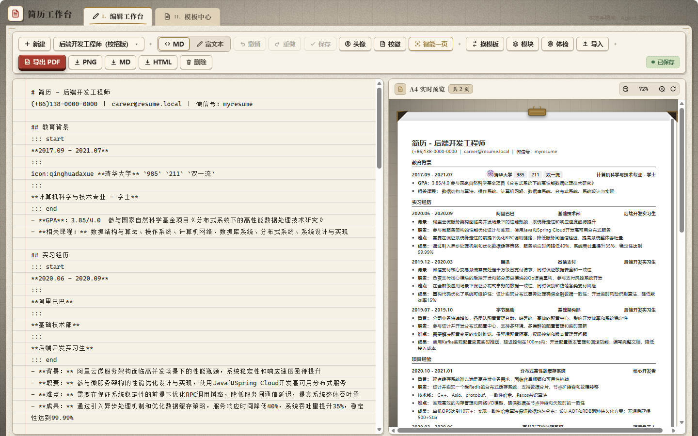
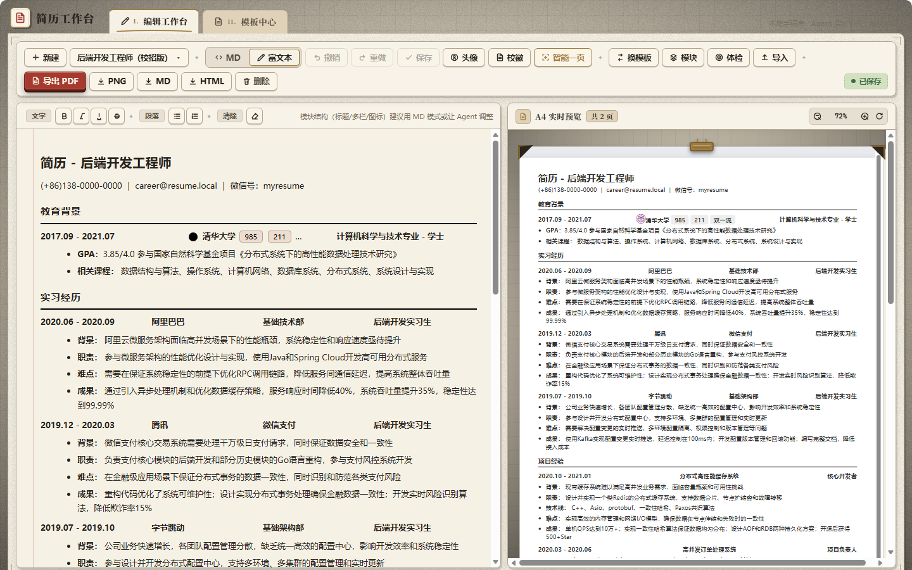
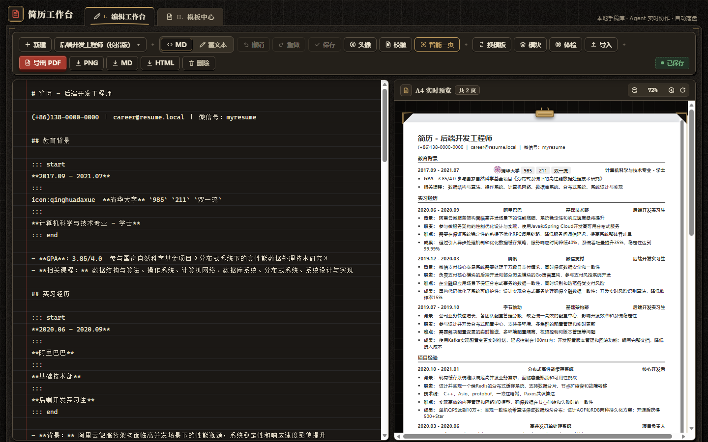
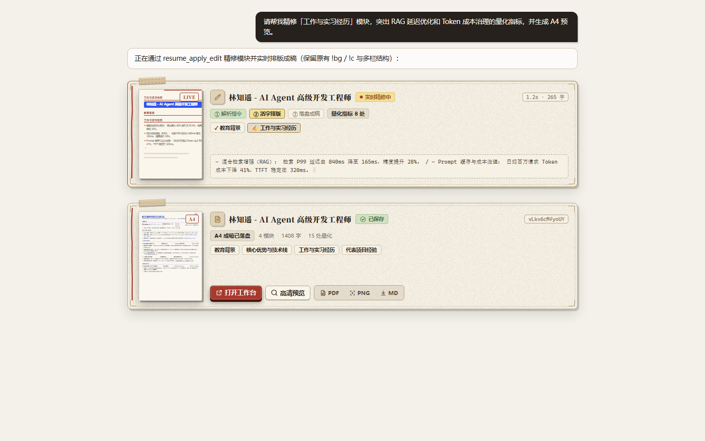
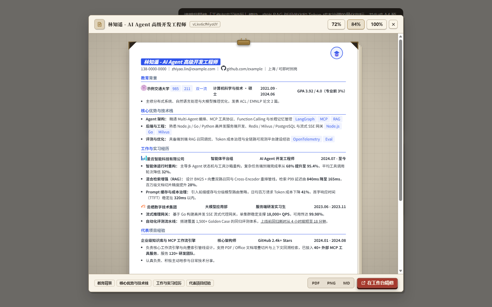
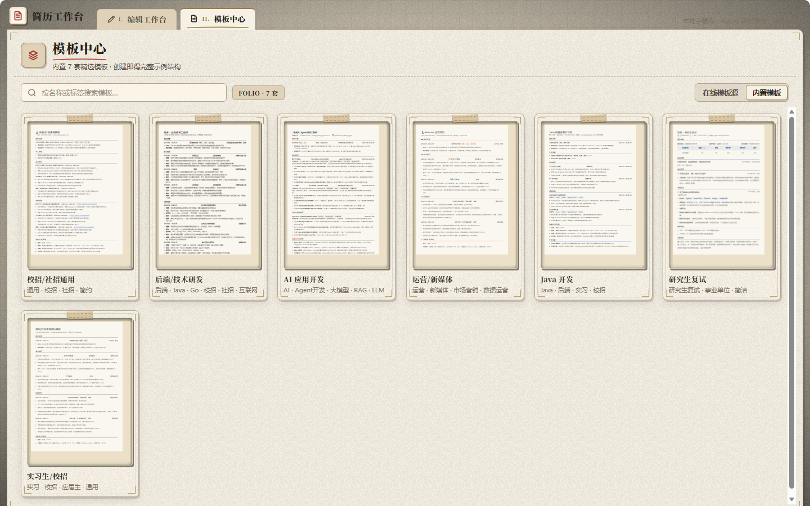
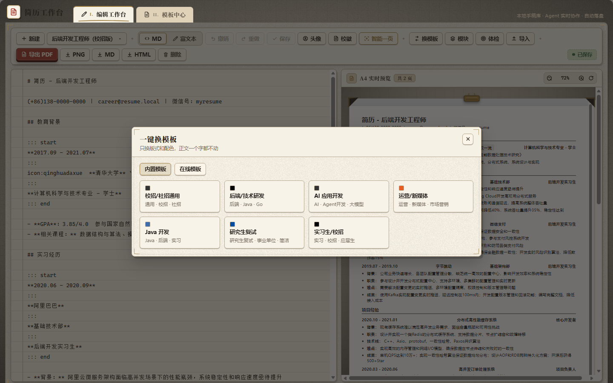
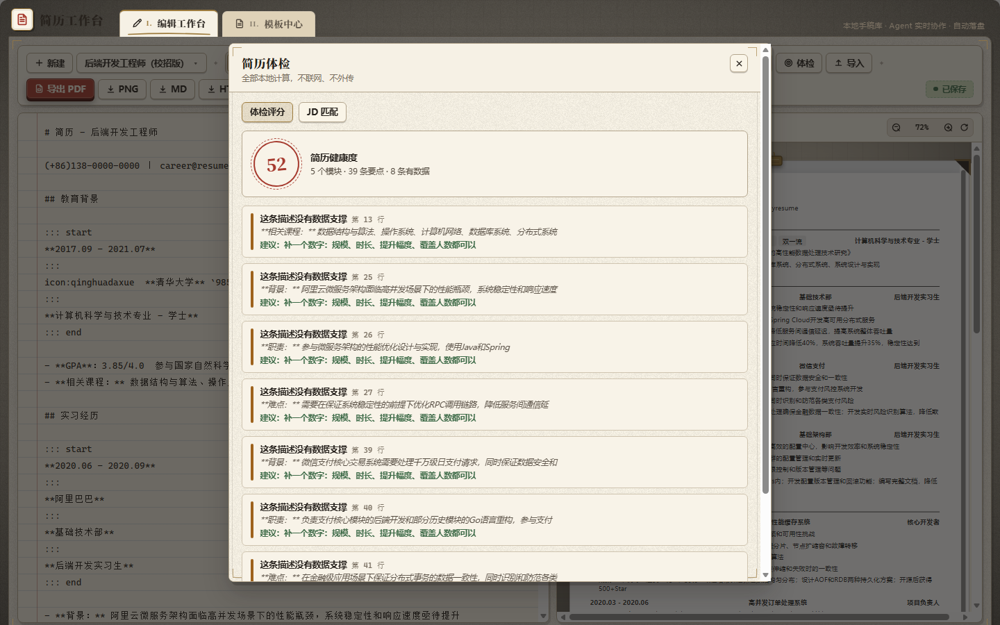
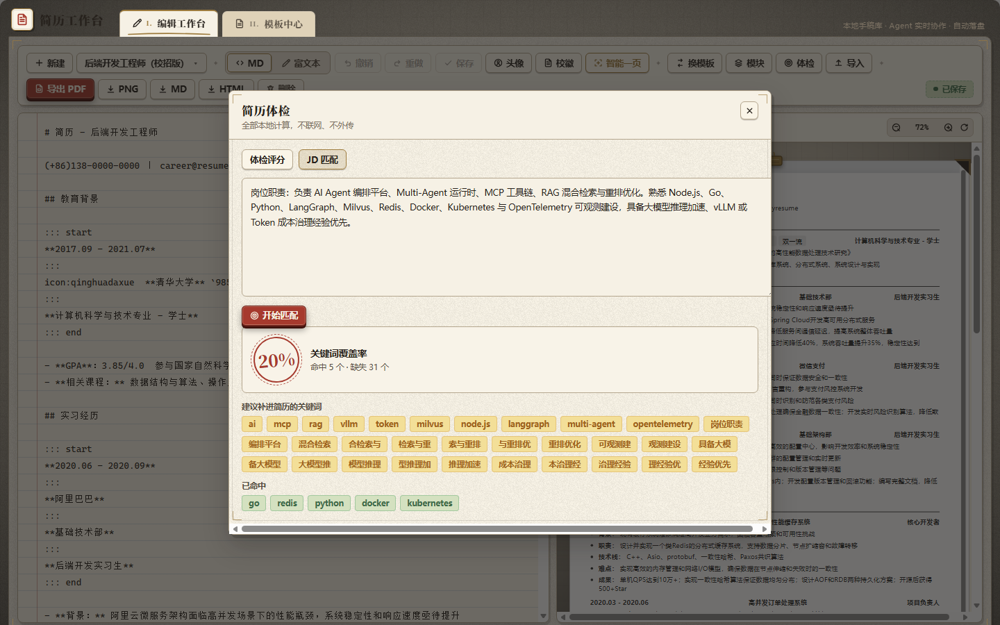
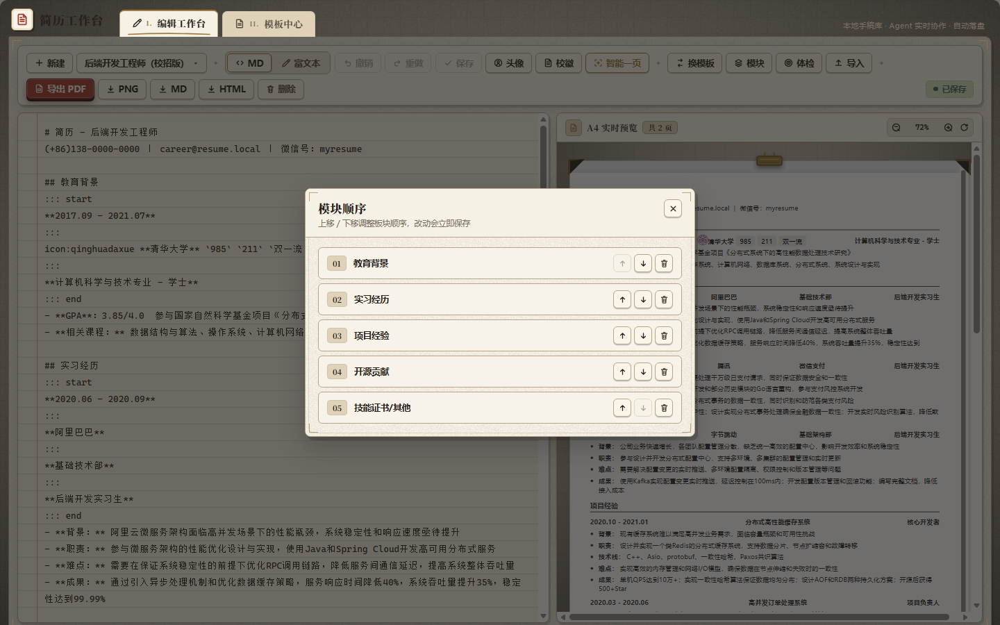

<div align="center">
  
  <h1>dsh-resume</h1>
  <p><strong>Local Resume Workbench Plugin for DeepSeek Harness</strong></p>
  <p>Dual-mode Markdown DSL & WYSIWYG Editing · Live 794×1123 A4 Preview · 27 Agent Tools · Fully Local & Watermark-free</p>

  <p>
    <a href="https://github.com/hzj206/dsh-resume/releases"></a>
    <a href="LICENSE"></a>
    <a href="https://github.com/deepseek-ai/deepseek-harness"></a>
    = 20" />
    
  </p>

  <p>
    <a href="README.md">简体中文</a> · <strong>English</strong>
  </p>
  <p>
    <a href="#preview">🖼️ Overview</a> ·
    <a href="#quick-start">🚀 Quick Start</a> ·
    <a href="#features">✨ Features & Screenshots</a> ·
    <a href="#workflows">💡 Workflows</a> ·
    <a href="#agent-tools">🤖 Agent Tools</a> ·
    <a href="#dsl">📝 Resume DSL</a> ·
    <a href="#config">⚙️ Configuration</a> ·
    <a href="#architecture">📦 Structure</a>
  </p>
</div>

---

<div align="center">
  
  <p><sub>Scriptorium Split-Pane Workbench: Markdown DSL source on the left, live <code>794 × 1123 px</code> A4 rendering with draggable school logo & photo overlays on the right</sub></p>
</div>

> [!IMPORTANT]
> **Install Spec (copy directly into DSH Plugins or CLI):**
> ```text
> github:hzj206/dsh-resume
> ```

---

## <a id="preview"></a>🖼️ Feature Overview

`dsh-resume` integrates directly into DeepSeek Harness across the **main center-pane workbench**, **right sidebar tab**, **in-chat streaming tool cards**, and **Agent skill registry**—covering the full workflow from initial draft to JD-targeted iteration and print-ready PDF/PNG export:

| Capability | Highlights |
|---|---|
| **Dual-Mode Editor** | Seamless switching between **Markdown DSL source** and **WYSIWYG rich-text editing** with independent undo/redo stacks, `1200ms` auto-save, and `.rev` conflict protection |
| **Live A4 & Smart One-Page** | Exact `794 × 1123 px` A4 canvas with synchronized preview updates, multi-page pagination support, and one-click **Smart One-Page** auto-scaling |
| **Deep Agent Collaboration** | **27 structured tools** + auto-synced `resume-studio` skill, **LIVE streaming chat cards**, and an interactive **A4 High-Res Lightbox** |
| **Template Center & Live Swap** | **7 built-in scenario templates** + **120+ online templates**; switch layout & color schemes **without changing a single word of content**, with local CSS caching |
| **Offline Proofread & JD Match** | 100% local rule engine (no network calls): 0–100 health score, quantification ratio, cliché/weak-verb detection, and JD keyword coverage analysis |
| **Import & Multi-Format Export** | Import `.md` / `.txt` / `.html` / `.json` (style/layout extraction + XSS sanitization); export clean **PDF**, 1:1 **PNG**, self-contained **HTML**, and **Markdown** |
| **Adaptive Theme & Privacy** | Follows host **Daylight Parchment / Dark Nocturne** theme automatically; zero login, zero cloud upload, zero watermarks—everything stays in `~/.dsh/dsh-resume/` |

---

## <a id="quick-start"></a>🚀 Quick Start

### Requirements

| Item | Requirement |
|---|---|
| Host | DeepSeek Harness (Web & Desktop) |
| Node.js | `>= 20` |
| npm dependencies | **0 external dependencies** |
| Export engine (optional) | **Microsoft Edge** or **Google Chrome** installed on the system for headless PDF / PNG export |

### Installation

#### Option 1: DSH GUI (Recommended)

1. Open DeepSeek Harness and navigate to **Plugins → Add plugin** in the sidebar.
2. Enter either of the following specs:
   - GitHub shorthand: `github:hzj206/dsh-resume`
   - Full Git URL: `https://github.com/hzj206/dsh-resume.git`
3. Enable the bundle (restart DSH once if config HMR is disabled).

#### Option 2: `dsh plugin` CLI

```bash
# Install into the Web profile
dsh plugin --profile web add github:hzj206/dsh-resume

# Or into a custom profile
dsh plugin --profile <profile-name> add github:hzj206/dsh-resume
```

> [!TIP]
> - On Windows PowerShell, use `dsh.cmd` if execution policies block `.ps1` wrappers.
> - For offline setups, download the `.tgz` asset from [GitHub Releases](https://github.com/hzj206/dsh-resume/releases) and run `dsh plugin --profile web add ./dsh-resume-1.0.5.tgz`.

#### Option 3: Install via Agent Chat

Send this prompt directly to your DSH Agent:

> Install and enable plugin: `github:hzj206/dsh-resume`

#### Option 4: Local Clone

```bash
git clone https://github.com/hzj206/dsh-resume.git
```

Select the cloned directory in **Plugins → Add plugin**, or run `dsh plugin --profile web add ./dsh-resume`.

<details>
<summary><b>Upgrade & Uninstall</b></summary>

```bash
# Re-install latest from GitHub
dsh plugin --profile web add github:hzj206/dsh-resume

# Remove plugin (keeps your personal resumes in ~/.dsh/dsh-resume/ intact)
dsh plugin --profile web remove dsh-resume
```

</details>

---

## <a id="features"></a>✨ Features & Real Screenshots

### 1. Dual-Mode Editor (Markdown DSL ↔ WYSIWYG) & Adaptive Dark Theme

- **Markdown DSL Source Mode**: Full control over `!bg` title bars, `!c` segmented headings, `::: start/end` multi-column rows, `icon:*` glyphs, `` `tag` `` badges, and `++underline++`, rendered live on the right `794×1123` A4 paper.
- **WYSIWYG Rich-Text Mode**: Switch to **WYSIWYG** for a familiar rich-text toolbar (bold, italic, underline, strikethrough, ordered/unordered lists, clear formatting, undo/redo) with lossless AST/DOM round-tripping for nested lists, GFM tables, and inline styles, guarded against race-condition overwrites.
- **Host Theme Sync**: Automatically mirrors DSH's light/dark theme (`data-ds-dark-theme` / `theme/change`) while keeping the A4 resume canvas crisp white paper.

<table>
  <tr>
    <td width="50%" align="center">
      
      <br /><sub><b>WYSIWYG Mode</b>: Rich-text formatting toolbar & live block editing</sub>
    </td>
    <td width="50%" align="center">
      
      <br /><sub><b>Dark Theme Sync</b>: Low-glare workspace with true-white A4 paper preview</sub>
    </td>
  </tr>
</table>

---

### 2. In-Chat Streaming Tool Cards & A4 High-Res Lightbox

Watch the Agent build and refine your resume right inside the conversation stream:

- **LIVE Streaming Card**: Shows real-time progress stages (`Parse → Typeset → Save`), detected section pills, quantified metric counters, and a scrolling miniature draft preview.
- **Settled Card & Lightbox**: Renders a live A4 thumbnail (`?print=1&thumb=1`) with one-click **Open Workbench**, **High-Res Preview Lightbox** (`72% / 84% / 100%` zoom + multi-page count), and instant **PDF / PNG / MD** export buttons.

<table>
  <tr>
    <td width="50%" align="center">
      
      <br /><sub><b>In-Chat Tool Cards</b>: LIVE streaming progress card & settled A4 preview card</sub>
    </td>
    <td width="50%" align="center">
      
      <br /><sub><b>A4 High-Res Lightbox</b>: 72% / 84% / 100% zoom, quick export & workbench jump</sub>
    </td>
  </tr>
</table>

---

### 3. Template Center & One-Click Style Swap (Zero Text Changes)

- **Template Center**: Browse **7 built-in scenario templates** (General, Backend/Tech, AI Agent, Ops, Java, Graduate, Intern) rendered live locally, plus **120+ online templates** with keyword search and tag filtering.
- **One-Click Template Swap**: Apply any built-in or online template's typography, layout, and palette to your current resume **without modifying a single character of text**. Online template CSS is cached locally for offline exports.

<table>
  <tr>
    <td width="50%" align="center">
      
      <br /><sub><b>Template Center</b>: 7 built-in live previews + 120+ online templates</sub>
    </td>
    <td width="50%" align="center">
      
      <br /><sub><b>One-Click Swap</b>: Switch visual theme & layout while preserving all content</sub>
    </td>
  </tr>
</table>

---

### 4. Offline Resume Checkup & JD Keyword Matching

Click **Checkup (`体检`)** to run 100% local diagnostics (no internet access, no external uploads):

- **Health Check (0–100 Score)**: Counts sections, bullet points, and quantified metrics; flags missing contact details, clichés, weak verbs, unquantified bullets, overly long lines, and mixed punctuation with line-numbered suggestions.
- **JD Keyword Match**: Paste any job description to compute keyword coverage (%) and inspect **missing keywords** vs **matched keywords**.

<table>
  <tr>
    <td width="50%" align="center">
      
      <br /><sub><b>Offline Checkup</b>: 0–100 health stamp, bullet metrics & graded advice</sub>
    </td>
    <td width="50%" align="center">
      
      <br /><sub><b>Offline JD Match</b>: Coverage score with matched & missing keyword chips</sub>
    </td>
  </tr>
</table>

---

### 5. Section Reordering, Draggable Overlays, Import & Export

- **Section Organizer**: Reorder or remove `##` sections visually (with fence-aware parsing that ignores headings inside `::: start/end` multi-column blocks).
- **Draggable Photo & Logo**: Upload a portrait photo (square/circle) or school/company logo (SVG/PNG) and drag it directly on the A4 preview paper—coordinates persist automatically.
- **Import & Multi-Format Export**: Import `.md` / `.txt` / `.html` / `.json` (with HTML layout/style extraction & XSS sanitization). Export print-ready **PDF**, 1:1 DPI-locked **PNG** (single or multi-page), offline self-contained **HTML**, and **Markdown**. Toggle **Smart One-Page** on or off depending on whether you want auto-fit 1-page scaling or a multi-page CV.

<div align="center">
  
  <br /><sub><b>Section Organizer</b>: Move sections up/down or trim sections with instant persistence</sub>
</div>

---

## <a id="workflows"></a>💡 Example Agent Prompts

- **Draft from scratch**: *"Create a new resume using the `ai_agent` template for a Backend & Agent Engineer, scaffold quantified bullets and mark placeholders for metrics."*
- **Targeted section polish**: *"Read my current resume and use `resume_apply_edit` to rewrite the internship section with STAR metrics without touching other sections."*
- **JD tailoring**: *"Run `resume_match_jd` against this job description, list missing keywords, and integrate the ones matching my real experience."*
- **Interview prep & skill alignment**: *"Search recent backend interview experiences with `mianjing_search` and check if my skills section highlights those topics."*
- **Export**: *"Enable Smart One-Page and export my resume to both PDF and self-contained HTML."*

---

## <a id="agent-tools"></a>🤖 Agent Tools (27 Total)

- **Resume CRUD, Import & Section Editing (11)**: `resume_list`, `resume_new`, `resume_read`, `resume_write`, `resume_import`, `resume_duplicate`, `resume_delete`, `resume_sections`, `resume_move_section`, `resume_apply_edit`, `resume_render`
- **Styling, Overlays & Export (8)**: `resume_set_template`, `resume_set_style`, `resume_set_auto_page`, `resume_set_avatar`, `resume_set_avatar_position`, `resume_set_school_logo`, `resume_set_school_logo_position`, `resume_export`
- **Diagnostics, Templates & Job Intel (8)**: `resume_proofread`, `resume_match_jd`, `template_list`, `template_get`, `mianjing_companies`, `mianjing_search`, `mianjing_detail`, `jobs_search`

---

## <a id="dsl"></a>📝 Resume DSL Quick Reference

```markdown
### !bg[*Alex Zhang - Backend Engineer*](#2F54EB)

138-0000-0000 ｜ career@example.com ｜ icon:github github.com/example

## !c[Education](#2F54EB)!c[Background](#64748B)

::: start
icon:qinghuadaxue **Example University** `CS` `B.S.`
:::
**2022.09 - 2026.06**
::: end
```

- `!bg[text](#hex)`: Highlighted title bar with automatic foreground contrast (dark ink on light fills, white text on dark fills)
- `!c[text](#hex)`: Multi-color section heading segments
- `::: start ... ::: ... ::: end`: Adaptive multi-column layout row (2–4 columns, each delimiter on its own line)
- `` `tag` ``: Theme-colored badge chip
- `icon:<name>`: 200+ built-in iconfont glyphs (`icon:github`, `icon:bytedance`, `icon:alibaba`, `icon:tencent`, `icon:leetcode`, etc.)
- `++text++`: Underline; `~~text~~`: Strikethrough

---

## <a id="config"></a>⚙️ Configuration & Storage

| Key | Type | Default | Description |
|---|---|---|---|
| `storageDir` | `string` | `~/.dsh/dsh-resume` | Local resume, overlay & export storage directory |
| `browserPath` | `string` | Auto-detected | Custom Edge / Chrome binary path for PDF & PNG export |
| `onlineTemplates` | `boolean` | `true` | Enable/disable online template gallery (`false` for fully offline mode) |

---

## <a id="architecture"></a>📦 Project Structure

```text
dsh-resume/
├── package.json            # Bundle manifest, client injections & exports
├── cordis.patch.yml        # Cordis plugin patch
├── icon.svg                # Plugin icon
├── locale/                 # Localized metadata (en.json / zh.json)
├── docs/
│   ├── DETAIL.md           # Plugin manager detail page
│   └── images/             # Real UI feature screenshots
├── skills/resume-studio/   # Agent skill guide synced to ~/.dsh/skills/
├── assets/                 # Built-in templates, A4 CSS, markdown-transform-html (MIT), GSAP, iconfont
└── lib/
    ├── index.js            # Host storage engine, HTTP API & 27 Agent tools
    ├── client.js           # Scriptorium Workbench, Template Center & Chat ToolView cards
    ├── dsl.js              # DSL fence normalization, balanced tag parser & contrast math
    ├── importer.js         # Multi-format importer (HTML/MD/TXT/JSON) & XSS sanitizer
    ├── fidelity.js         # High-fidelity A4 rendering pipeline
    ├── render.js           # Lightweight fragment renderer for WYSIWYG mode
    ├── features.js         # Section operations, offline proofread & JD matching
    └── exporter.js         # Headless Edge/Chrome PDF/PNG export & pagination crop
```

---

## 🤝 Credits & License

- Markdown rendering powered by [markdown-transform-html](https://github.com/Acmenlei/markdown-plus) ([MIT License](assets/vendor/markdown-transform-html.LICENSE))
- Plugin integration inspired by DeepSeek Harness documentation & [dsh-univer-office](https://github.com/dream-num/dsh-univer-office)
- Licensed under [MIT](LICENSE)
