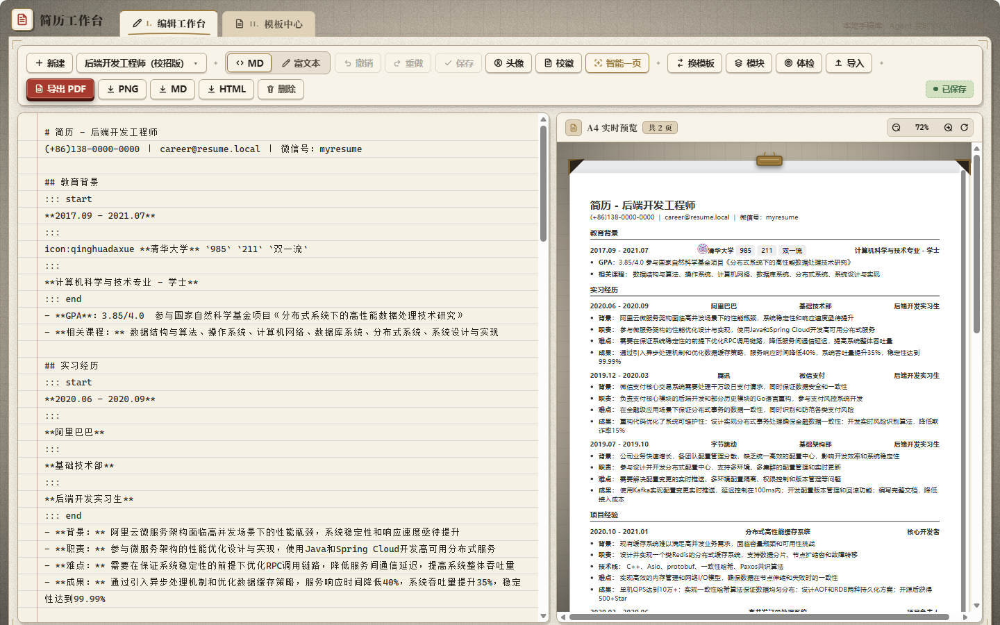
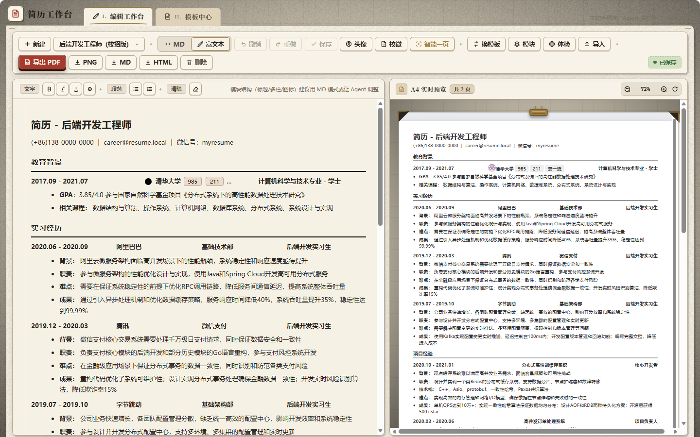
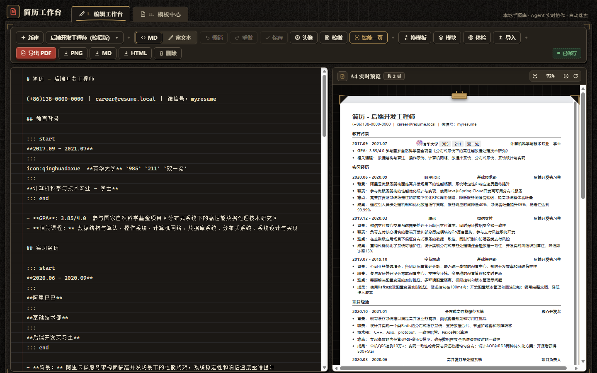
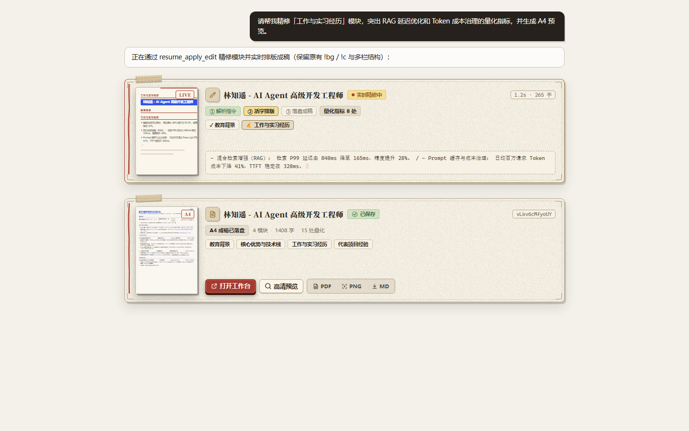
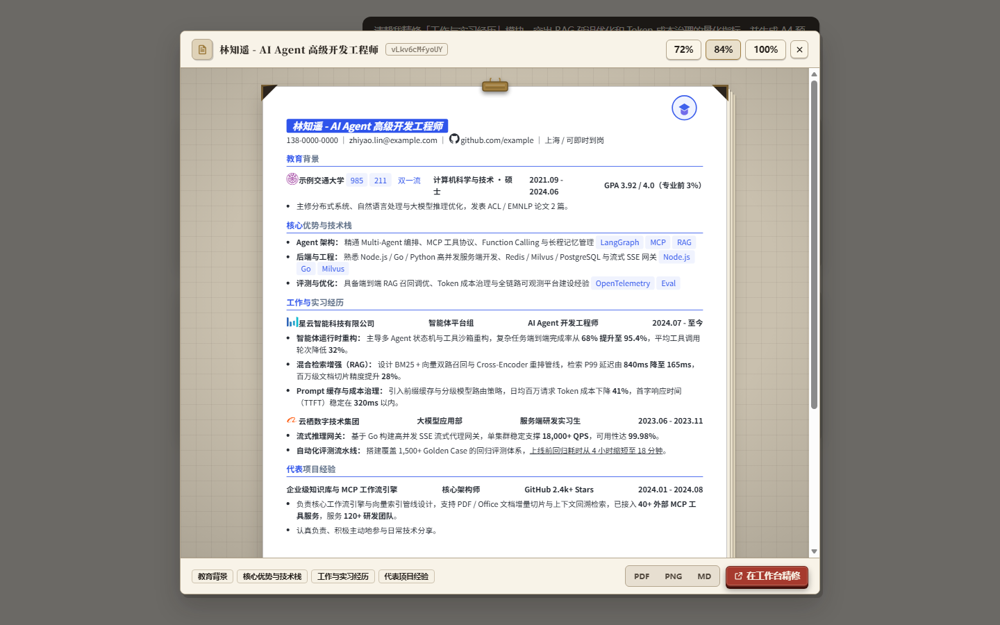
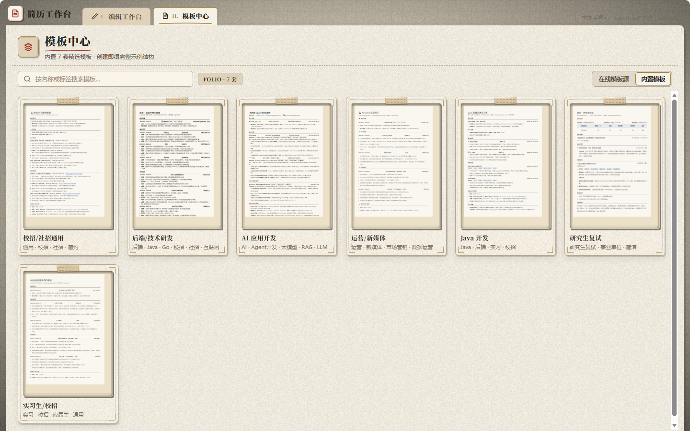
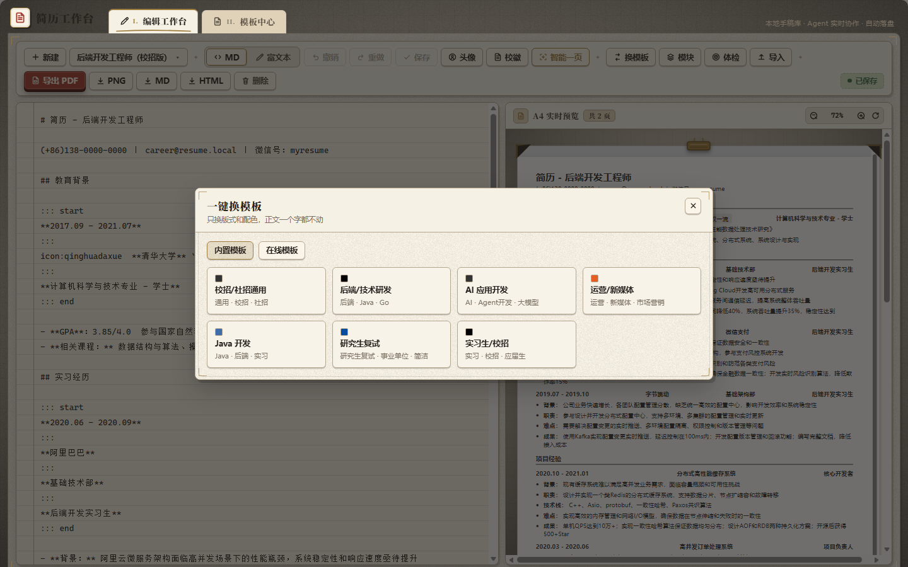
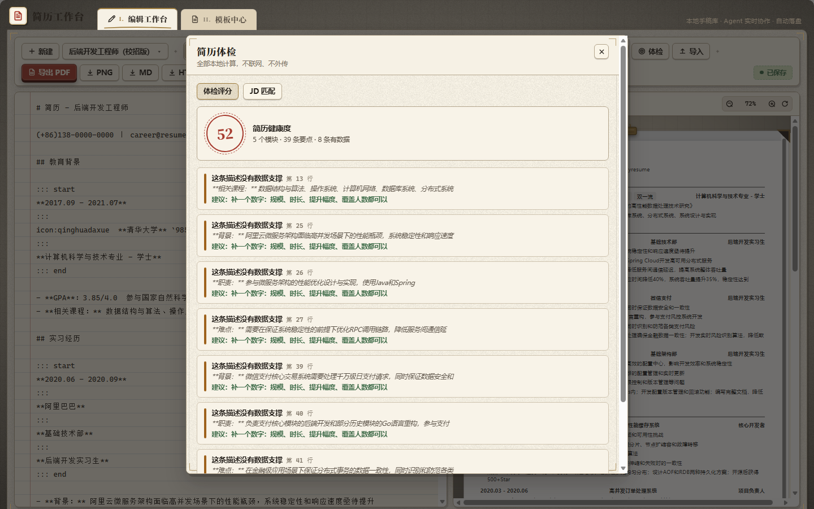
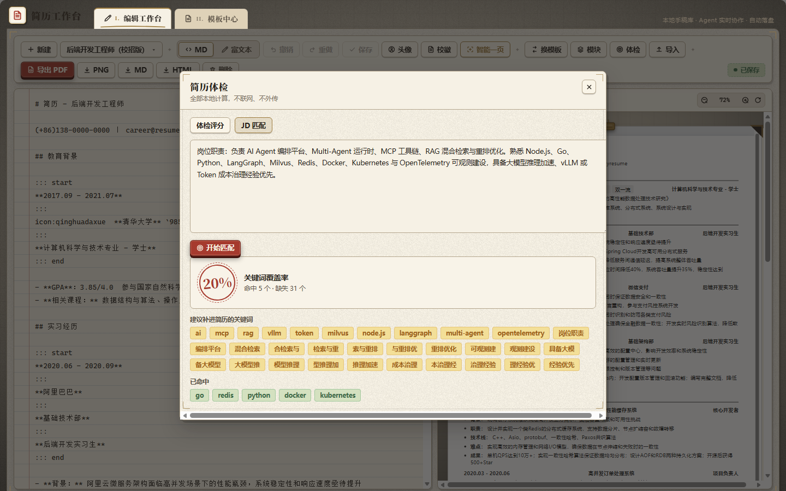
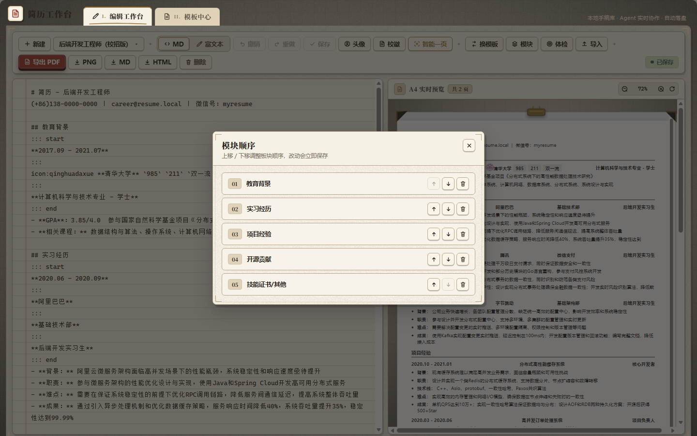

<div align="center">
  
  <h1>dsh-resume</h1>
  <p><strong>DeepSeek Harness 本地简历工作台插件</strong></p>
  <p>Markdown DSL 与富文本双模式编辑 · 794×1123 A4 实时排版 · 27 个 Agent 协作工具 · 纯本地无水印</p>

  <p>
    <a href="https://github.com/hzj206/dsh-resume/releases"></a>
    <a href="LICENSE"></a>
    <a href="https://github.com/deepseek-ai/deepseek-harness"></a>
    = 20" />
    
  </p>

  <p>
    <strong>简体中文</strong> · <a href="README.en.md">English</a>
  </p>
  <p>
    <a href="#preview">🖼️ 功能预览</a> ·
    <a href="#quick-start">🚀 快速开始</a> ·
    <a href="#features">✨ 功能详解</a> ·
    <a href="#workflows">💡 典型玩法</a> ·
    <a href="#agent-tools">🤖 Agent 工具</a> ·
    <a href="#dsl">📝 DSL 语法</a> ·
    <a href="#config">⚙️ 配置与存储</a> ·
    <a href="#architecture">📦 项目结构</a>
  </p>
</div>

---

<div align="center">
  
  <p><sub>Scriptorium 双栏简历工作台：左侧 Markdown DSL 源码编辑，右侧严格 <code>794 × 1123 px</code> A4 实时渲染预览与校徽/证件照拖拽定位</sub></p>
</div>

> [!IMPORTANT]
> **安装标识（直接复制填入 DSH 插件安装框或命令行）：**
> ```text
> github:hzj206/dsh-resume
> ```

---

## <a id="preview"></a>🖼️ 核心功能一览

`dsh-resume` 深度集成到 DeepSeek Harness 的 **主栏整页工作台**、**右侧栏快捷面板**、**对话流内嵌工具卡片** 以及 **Agent 技能系统** 中，覆盖从灵感草稿、AI 协作精修、JD 定向匹配到印刷级 PDF/PNG 导出的全链路：

| 功能特性 | 核心亮点 |
|---|---|
| **双模式编辑器** | **Markdown DSL 源码** ↔ **富文本所见即所得（WYSIWYG）** 一键切换，独立撤销/重做栈 + `1200ms` 自动保存 + 修订号 `.rev` 防覆盖锁 |
| **A4 实时渲染 & 智能一页** | 严格 `794 × 1123 px` 标准 A4 纸面，支持局部滚动同步、多页长简历分页预览、以及一键开启「智能一页」自动缩放 |
| **Agent 深度协作** | 暴露 **27 个结构化工具**，自动同步 `resume-studio` 技能手册；对话流内置 **LIVE 实时排版卡片** 与 **A4 高清阅览灯箱** |
| **模板中心 & 一键换肤** | 内置 **7 套场景模板** + **120+ 在线模板源**；支持**只换版式配色不改正文**，并自动缓存 CSS 以支持离线导出 |
| **离线体检 & JD 匹配** | 纯本地规则引擎（不联网、不外传）：0–100 分健康体检、量化指标统计、弱动词/空话识别、岗位 JD 关键词覆盖率分析 |
| **外部导入 & 多格式导出** | 导入 `.md` / `.txt` / `.html` / `.json`（自动提取样式与多栏并清洗 XSS）；导出无页眉页脚 **PDF**、1:1 高清 **PNG**、离线自包含 **HTML** 与 **Markdown** |
| **主题自适应 & 隐私安全** | 跟随宿主自动切换 **日间羊皮纸 / 暗夜墨韵（Nocturne）** 主题；无账号、无云端上传、无导出水印，全部落盘 `~/.dsh/dsh-resume/` |

---

## <a id="quick-start"></a>🚀 快速开始

### 环境要求

| 项目 | 说明 |
|---|---|
| 宿主环境 | DeepSeek Harness（Web / Desktop 桌面端通用） |
| Node.js | `>= 20` |
| 外部 npm 依赖 | **0 依赖**（安装无需拉取第三方依赖树，开箱即用） |
| 导出引擎（可选） | 本机已安装 **Microsoft Edge** 或 **Google Chrome**（用于无头打印高精度 PDF / PNG，Windows 通常开箱自带；未检测到时 PNG 会回退内置渲染能力） |

### 安装方式

#### 方式一：DSH 图形界面安装（推荐）

1. 打开 DeepSeek Harness，进入侧栏 **「插件」→「添加插件」**。
2. 填入以下任意一种地址并确认安装：
   - GitHub 短格式：`github:hzj206/dsh-resume`
   - Git 完整地址：`https://github.com/hzj206/dsh-resume.git`
3. 安装完成后开启启用开关即可使用（如未启用配置热重载，重启一次 DSH 即可生效）。

#### 方式二：`dsh plugin` 命令行安装

```bash
# 安装到 Web profile
dsh plugin --profile web add github:hzj206/dsh-resume

# 或安装到其他自定义 profile
dsh plugin --profile <profile-name> add github:hzj206/dsh-resume
```

> [!TIP]
> - Windows PowerShell 如遇脚本执行策略限制，请将 `dsh` 替换为 `dsh.cmd`。
> - 离线环境可从 [GitHub Releases](https://github.com/hzj206/dsh-resume/releases) 下载 `.tgz` 归档执行：`dsh plugin --profile web add ./dsh-resume-1.0.5.tgz`。

#### 方式三：让 Agent 自动安装

直接在 DSH 对话框发送：

> 帮我安装并启用插件：`github:hzj206/dsh-resume`

#### 方式四：克隆源码本地安装

```bash
git clone https://github.com/hzj206/dsh-resume.git
```

然后在 DSH **「插件 → 添加插件」** 选择克隆目录，或执行 `dsh plugin --profile web add ./dsh-resume`。

<details>
<summary><b>升级与卸载命令</b></summary>

```bash
# 重新安装最新版
dsh plugin --profile web add github:hzj206/dsh-resume

# 卸载插件（不会删除 ~/.dsh/dsh-resume/ 下保存的个人简历文件）
dsh plugin --profile web remove dsh-resume
```

</details>

### 上手 4 步走

1. 安装启用后，在侧栏顶部全局面板点击 **「简历工作台」**（或展开右侧栏工作台标签页）。
2. 点击 **「＋ 新建」** 挑选内置模板，或点 **「导入」** 上传现有 `.md / .html / .txt / .json` 简历，也可以直接在对话中向 Agent 描述你的背景。
3. 在对话流或工作台中协同打磨内容，用 **「体检」** 查漏补缺、**「换模板」** 尝试不同配色排版。
4. 点击顶栏 **「导出 PDF」**（发给 HR 首选）或 **PNG / HTML / MD** 获取成稿文件。

---

## <a id="features"></a>✨ 功能详解与实景截图

### 1. 双模式编辑器（Markdown DSL ↔ 富文本 WYSIWYG）与暗夜主题

- **Markdown DSL 源码模式**：支持完整的 Resume DSL 语法（`!bg` 标题条、`!c` 局部着色、`::: start/end` 多栏行、`icon:*` 图标、`` `标签` `` 徽章、`++下划线++`），配合右侧 `794×1123` A4 预览实时刷新。
- **富文本所见即所得（WYSIWYG）模式**：不习惯写语法时可一键切至 **「富文本」**，顶部浮动工具栏支持**加粗、斜体、下划线、删除线、无序/有序列表、清除格式**及 `Ctrl+Z` / `Ctrl+Y` 撤销重做；切换回 MD 时自动无损还原列表缩进、GFM 表格与内联样式，并内置未载入保护与保存锁，杜绝切屏误覆写。
- **宿主主题自适应**：自动监听 DSH 主题状态（`data-ds-dark-theme` / `theme/change`），工作台无缝切换至暗夜墨韵模式，同时保持 A4 预览纸面为纯白印刷底色。

<table>
  <tr>
    <td width="50%" align="center">
      
      <br /><sub><b>富文本（WYSIWYG）模式</b>：浮动工具条 + 实时排版块编辑</sub>
    </td>
    <td width="50%" align="center">
      
      <br /><sub><b>暗夜模式自适应</b>：护眼暗色工作台 + 纯白 A4 预览纸面</sub>
    </td>
  </tr>
</table>

---

### 2. 对话流内嵌 Agent 工具卡片 & A4 高清阅览灯箱

在对话中让 Agent 新建或修改简历时，无需切出聊天窗口即可直接看到进度与结果：

- **生成中（LIVE 态）**：实时显示当前处于 **「① 解析指令 → ② 活字排版 → ③ 落盘成稿」** 哪一阶段、已识别的模块胶囊、量化指标数量与微缩草稿滚动预览。
- **成稿后（Settled 态）**：展示带真实 A4 缩略预览的实体卡片，支持一键 **「打开工作台」**、点击缩略图或 **「高清预览」** 打开支持 `72% / 84% / 100%` 缩放与多页计数的高清灯箱，以及 **PDF / PNG / MD** 原地导出。

<table>
  <tr>
    <td width="50%" align="center">
      
      <br /><sub><b>对话流内嵌工具卡片</b>：上方为 LIVE 实时排版进度，下方为已落盘 A4 预览卡片</sub>
    </td>
    <td width="50%" align="center">
      
      <br /><sub><b>A4 高清阅览灯箱</b>：支持 72% / 84% / 100% 缩放、快捷导出与跳转精修</sub>
    </td>
  </tr>
</table>

---

### 3. 模板中心 & 一键换模板（正文零改动）

- **模板中心（`II. 模板中心`）**：内置 **7 套精选场景模板**（校招/社招通用、后端/技术研发、AI Agent 应用开发、运营/新媒体、Java 开发、研究生复试、实习生/校招），每套自带完整结构示范与实时 A4 缩略预览；同时接入 **120+ 在线公开版式库**，支持关键词检索与标签过滤。
- **一键换模板**：点击工具栏 **「换模板」**，可对当前简历任意套用内置或在线模板的版式与配色，**正文内容一个字都不动**。已使用的在线模板会自动缓存 CSS 至本地，后续离线同样可查看与导出。

<table>
  <tr>
    <td width="50%" align="center">
      
      <br /><sub><b>模板中心</b>：内置 7 套 + 在线 120+ 版式，支持搜索筛选与实时渲染预览</sub>
    </td>
    <td width="50%" align="center">
      
      <br /><sub><b>一键换模板</b>：切换版式主题配色，正文内容完整保留</sub>
    </td>
  </tr>
</table>

---

### 4. 本地简历体检 & 离线 JD 关键词匹配

点击工具栏 **「体检」** 打开诊断弹窗（纯本地算法计算，**绝不联网、绝不上传简历原文**）：

- **简历健康度体检（0–100 分）**：统计模块数量、要点数量与含数字量化要点比例；精准检出联系方式缺失、空洞套话（如“认真负责/积极主动”）、弱动词开头、缺少量化数据、单条过长及中英文标点混用等问题，给出带行号的修改建议。
- **岗位 JD 关键词匹配**：粘贴招聘 JD 原文即可算出关键词覆盖率，并以红/绿标签清晰区分 **「建议补进简历的关键词」** 与 **「已命中关键词」**，配合 Agent 的 `resume_apply_edit` 即可快速定制定向投递版本。

<table>
  <tr>
    <td width="50%" align="center">
      
      <br /><sub><b>本地简历体检</b>：0–100 评分印章 + 量化统计 + 带行号改进建议</sub>
    </td>
    <td width="50%" align="center">
      
      <br /><sub><b>离线 JD 匹配</b>：关键词覆盖率 + 缺失词与已命中词一目了然</sub>
    </td>
  </tr>
</table>

---

### 5. 模块调序、证件照/校徽拖拽、多格式导入与导出

- **模块顺序调整**：点击 **「模块」** 即可可视化上移/下移/删除任意 `##` 板块（自动识别 `::: start/end` 多栏围栏，避免误拆分栏内标题）。
- **证件照与校徽拖拽定位**：上传证件照（PNG/JPG/WebP，支持方形/圆形切换）或校徽/公司 Logo（支持 SVG/PNG），可直接在右侧 A4 预览纸面上用鼠标拖拽到理想位置，坐标自动实时持久化。
- **外部简历导入与多格式导出**：
  - **导入**：支持 `.md` / `.markdown` / `.txt` / `.html` / `.htm` / `.json`，HTML 导入可智能还原标题、多栏布局、列表缩进、`<hr>`、`` 与主题色，并自动剥离 `<script>` 与危险事件属性。
  - **导出**：**PDF**（Edge/Chrome headless 无页眉页脚真实排版打印）、**PNG**（锁定 `1:1` 缩放的 `794px` 标准 A4 单页/多页长图）、**HTML**（CSS 与图标字体全内联，发给他人断网可浏览）及 **Markdown** 源文。
  - **智能一页 vs 多页长简历**：开启「智能一页」自动计算缩放比例压入单页 A4；关闭后支持 2 页及以上长简历的真实分页预览与导出。

<div align="center">
  
  <br /><sub><b>模块顺序管理</b>：一键上移、下移或裁剪简历板块，改动实时同步工作台与预览</sub>
</div>

---

## <a id="workflows"></a>💡 典型对话协作玩法

安装插件后，`skills/resume-studio/SKILL.md` 会自动同步至 `~/.dsh/skills/resume-studio/`，你可以直接在对话框用自然语言与 Agent 协作：

- **从零建档**：*“帮我基于 `ai_agent` 模板创建一份简历，我叫林知遥，硕士研究方向是大模型 RAG，有两段智能体平台实习经历，先搭好骨架并标出需要我补充的数据。”*
- **局部量化精修**：*“读取我当前简历，用 `resume_apply_edit` 把实习经历改写为 STAR 量化表述，突出延迟优化和成本下降指标，不要改动其他板块。”*
- **对照 JD 定向改写**：*“帮我把这份简历和这段后端开发 JD 做一次 `resume_match_jd` 匹配，告诉我缺哪些关键词，并把确实做过的技术栈自然补进项目经验里。”*
- **面经调研补强**：*“用 `mianjing_search` 查一下字节跳动后端实习最近的高频面试考点，对照我的简历技能栏看看还需要突出什么。”*
- **一键排版导出**：*“帮我换一个深蓝简约风格的模板，开启智能一页后导出 PDF 和自包含 HTML。”*

---

## <a id="agent-tools"></a>🤖 Agent 工具清单（共 27 个）

<details open>
<summary><b>1. 简历 CRUD、导入与局部精修（11 个）</b></summary>

| 工具名 | 用途 |
|---|---|
| `resume_list` | 列出本地全部简历（`id`、名称、模板、更新时间） |
| `resume_new` | 基于指定内置模板创建新简历 |
| `resume_read` | 读取指定简历的 `meta` 样式配置与 Markdown 正文 |
| `resume_write` | 全量保存简历正文、名称与可选样式补丁（自动规范化围栏转义） |
| `resume_import` | 导入外部 Markdown / HTML / 纯文本简历为新简历（自动保留结构与安全清洗） |
| `resume_duplicate` | 复制简历（同步拷贝头像与校徽资源） |
| `resume_delete` | 永久删除指定简历 |
| `resume_sections` | 列出按 `##` 切分的模块序号与标题 |
| `resume_move_section` | 上移或下移指定模块，调整板块顺序 |
| `resume_apply_edit` | **局部改稿（首选）**：仅替换指定模块正文，其余模块原样保留 |
| `resume_render` | 生成自包含预览 HTML 文件供自查排版 |

</details>

<details>
<summary><b>2. 版式、样式、图片与导出（8 个）</b></summary>

| 工具名 | 用途 |
|---|---|
| `resume_set_template` | 一键切换内置模板或在线模板版式配色，不改动正文 |
| `resume_set_style` | 调整主文字色 `primaryColor`、模块主色 `primaryBGColor`、字体 `fontFamily` 与行高 `lineHeight` |
| `resume_set_auto_page` | 开关「智能一页」自动缩放（长简历可设为 `false`） |
| `resume_set_avatar` | 上传 Base64 dataURL 证件照/头像 |
| `resume_set_avatar_position` | 设置头像坐标 `(top, left)` 与形状（`square` / `circle`） |
| `resume_set_school_logo` | 上传 Base64 dataURL 校徽/Logo（支持 SVG/PNG） |
| `resume_set_school_logo_position` | 设置校徽坐标 `(top, left)` |
| `resume_export` | 导出为 `md` / `html` / `pdf` / `png` 至本地 `exports/` 目录 |

</details>

<details>
<summary><b>3. 诊断分析、模板与求职情报（8 个）</b></summary>

| 工具名 | 用途 |
|---|---|
| `resume_proofread` | 本地简历体检，输出 0–100 评分与分级改进建议 |
| `resume_match_jd` | 本地 JD 关键词覆盖率分析，输出命中词与缺失词 |
| `template_list` | 列出内置 7 套模板（`general` / `tech` / `ai_agent` / `ops` / `java` / `graduate` / `intern`） |
| `template_get` | 获取指定模板的完整示例正文与样式配置 |
| `mianjing_companies` | 查询面经库支持的公司列表及 `slug` |
| `mianjing_search` | 按公司、岗位、届别、批次检索公开面经 |
| `mianjing_detail` | 查看单条面经的完整题目与流程记录 |
| `jobs_search` | 按公司、岗位、城市、行业检索公开校招/实习岗位 |

</details>

---

## <a id="dsl"></a>📝 Resume DSL 语法速查

```markdown
### !bg[*张三 - 后端开发工程师*](#2F54EB)

138-0000-0000 ｜ career@example.com ｜ icon:github github.com/example

## !c[教育](#2F54EB)!c[背景](#64748B)

::: start
icon:qinghuadaxue **示例大学** `985` `211` `双一流`
:::
**计算机科学与技术 · 本科**
:::
**2022.09 - 2026.06**
::: end

## !c[实习](#2F54EB)!c[经历](#64748B)

::: start
icon:bytedance **示例公司**
:::
**基础架构组**
:::
**后端开发实习生**
:::
**2025.06 - 2025.09**
::: end

- 主导核心链路缓存重构，接口 P99 延迟从 **120ms 降至 35ms**，支撑 `10万+ QPS`
- 沉淀自动化回归方案，++端到端回归耗时缩短 60%++
```

常用语法说明：
- `!bg[文本](#hex)`：带底色条的标题块（自动根据背景色明暗匹配深墨色或纯白文字，保证对比度；内部避免再嵌套方括号 `[待填]`）
- `!c[文本](#hex)`：模块标题分段着色（若使用自带实心丝带/底块的在线模板，可直接使用纯文本 `## 模块名`）
- `::: start ... ::: ... ::: end`：自适应多栏布局行（支持 2–4 栏，每行标签与内容各自独立成行）
- `` `标签` ``：技能/荣誉徽章（自动跟随主题主色）
- `icon:<name>`：内置 200+ 公司/高校/技术图标（如 `icon:github`、`icon:bytedance`、`icon:alibaba`、`icon:tencent`、`icon:qinghuadaxue`、`icon:leetcode` 等）
- `++文本++`：下划线强调；`~~文本~~`：删除线

---

## <a id="config"></a>⚙️ 配置项与本地存储

### 插件配置

可在 DSH 插件配置中覆盖以下选项：

| 配置项 | 类型 | 默认值 | 说明 |
|---|---|---|---|
| `storageDir` | `string` | `~/.dsh/dsh-resume` | 本地简历、头像、校徽与导出目录 |
| `browserPath` | `string` | 自动探测 | 指定用于导出 PDF / PNG 的 Edge / Chrome 可执行文件路径 |
| `onlineTemplates` | `boolean` | `true` | 是否启用在线模板列表；设为 `false` 可完全离线运行（仅使用内置 7 套模板） |

### 本地存储结构

```text
~/.dsh/dsh-resume/
├── .rev                    # 变更版本号（用于工作台 3 秒轮询实时刷新与冲突检测）
├── .cache/tpl-css/         # 已使用在线模板的样式缓存（断网仍可导出）
├── exports/                # 导出的 PDF / PNG / HTML / MD 文件
└── <resume-id>/
    ├── meta.json           # 名称、模板类型、配色/字体、头像/校徽坐标、智能一页开关
    ├── resume.md           # 简历正文（Resume DSL Markdown）
    ├── avatar.*            # 可选证件照
    └── logo.*              # 可选校徽 / Logo
```

---

## <a id="architecture"></a>📦 项目结构

```text
dsh-resume/
├── package.json            # DSH bundle 清单、Client 注入声明与导出入口
├── cordis.patch.yml        # Cordis 插件挂载补丁
├── icon.svg                # 插件图标
├── locale/                 # 中英文元数据（en.json / zh.json）
├── docs/
│   ├── DETAIL.md           # 插件详情页说明
│   └── images/             # 功能实景截图资源
├── skills/resume-studio/   # 自动同步至 ~/.dsh/skills/ 的 Agent 写作技能手册
├── assets/
│   ├── templates.js        # 7 套开箱即用内置模板
│   ├── resume-layout.css   # A4 基础排版与图标配色样式
│   └── vendor/             # markdown-transform-html (MIT)、GSAP 与 iconfont 字体资源
└── lib/
    ├── index.js            # Host 服务端入口：存储引擎、HTTP API、27 个 Agent 工具
    ├── client.js           # Web / Desktop 前端工作台、双模式编辑器、模板中心与聊天工具卡片
    ├── dsl.js              # Resume DSL 围栏规范化、平衡括号解析与自动对比度计算
    ├── importer.js         # 多格式外部导入（HTML/MD/TXT/JSON）与 XSS 净化引擎
    ├── fidelity.js         # 高保真 A4 渲染管线
    ├── render.js           # 轻量 DSL 片段渲染引擎（用于所见即所得编辑器）
    ├── features.js         # 模块结构解析、本地简历体检与 JD 匹配引擎
    └── exporter.js         # Edge / Chrome headless PDF/PNG 导出与分页裁剪
```

---

## 🤝 致谢 / Credits

- Markdown 渲染核心基于开源项目 [markdown-transform-html](https://github.com/Acmenlei/markdown-plus)（[MIT License](assets/vendor/markdown-transform-html.LICENSE)）
- 面板扩展与工具交互参考 DeepSeek Harness 官方文档及社区插件实践（[dsh-univer-office](https://github.com/dream-num/dsh-univer-office)）

## 📄 License

[MIT](LICENSE)
