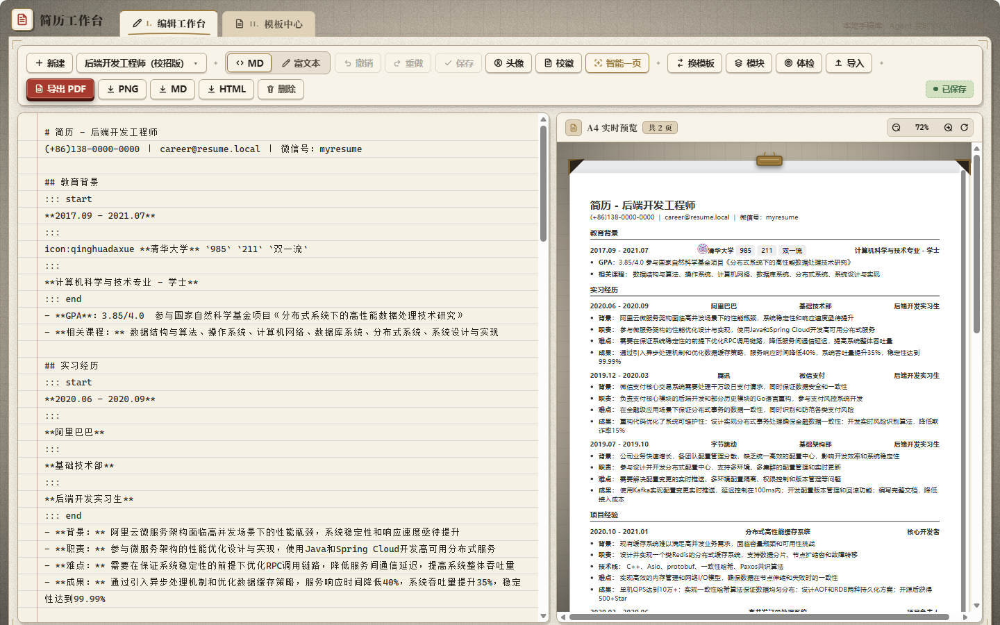

# 简历工作台 · dsh-resume

DeepSeek Harness 本地简历工作台：**Markdown DSL 与富文本双模式编辑 + 794×1123 A4 实时排版预览 + 27 个 Agent 协作工具**，无账号、纯本地存储、无水印。

## 核心能力

- **双模式工作台**（侧栏顶部全局面板 →「简历工作台」/ 右侧栏工作台标签页）：支持 **Markdown DSL 源码模式** 与 **富文本（WYSIWYG）所见即所得模式**无缝切换，右侧 `794×1123` A4 实时预览与缩放，并自动跟随宿主深浅色主题切换。
- **Agent 实时协作与聊天预览卡片**：向模型注册 27 个工具并自动同步 `resume-studio` 技能手册；Agent 精修或创建后，对话流内嵌 **LIVE 实时进度卡片** 与 **A4 微缩预览卡片**（支持点击弹出 `72%/84%/100%` 高清阅览灯箱与一键导出），工作台 3 秒内自动刷新。
- **Resume DSL 排版语法**：支持 `!bg[标题](#色)` 自动对比度底色条、`!c[字](#色)` 分段着色、`::: start / end` 多栏行、200+ `icon:name` 图标、`` `标签` `` 徽章与 `++下划线++`。
- **模板中心与一键换模板**：内置通用 / 技术研发 / AI Agent / 运营 / Java / 研究生复试 / 实习生 7 套场景模板 + 可选 120+ 在线模板库，支持只换版式配色而不改动正文，并自动缓存 CSS 供离线导出。
- **本地体检与 JD 匹配**：纯本地规则引擎（不联网、不外传），提供 0–100 分简历健康度评分、量化统计与改进建议，并支持粘贴 JD 一键分析关键词命中与缺失情况。
- **模块调序、导入与多格式导出**：支持可视化调整/裁剪 `##` 板块、导入 `.md / .txt / .html / .json`（自动提取样式与清洗 XSS），并支持导出无页眉页脚 **PDF**、1:1 高清 **PNG**（单页/多页）、自包含 **HTML** 与 **Markdown**。
- **证件照 / 校徽与智能一页**：上传后可在 A4 预览纸面上直接拖拽定位，支持方形/圆形头像；可自由开关「智能一页」自动缩放到单页或保留多页分页排版。
- **求职情报工具**：内置 `mianjing_search` / `mianjing_detail` / `mianjing_companies` / `jobs_search` 公开面经与岗位检索。
- **纯本地隐私**：所有数据存放在 `~/.dsh/dsh-resume/`，不上传个人简历内容。

## 环境说明

- **PDF / PNG 导出**优先调用本机已安装的 Microsoft Edge 或 Google Chrome（Windows 通常开箱自带；未检测到系统浏览器时 PNG 可自动退回内置浏览器截图）。
- 面板与 Agent 变更通过 `.rev` 修订号轮询同步；若存在未保存的手动编辑，顶部会弹出冲突横幅提示，防止误覆盖。
